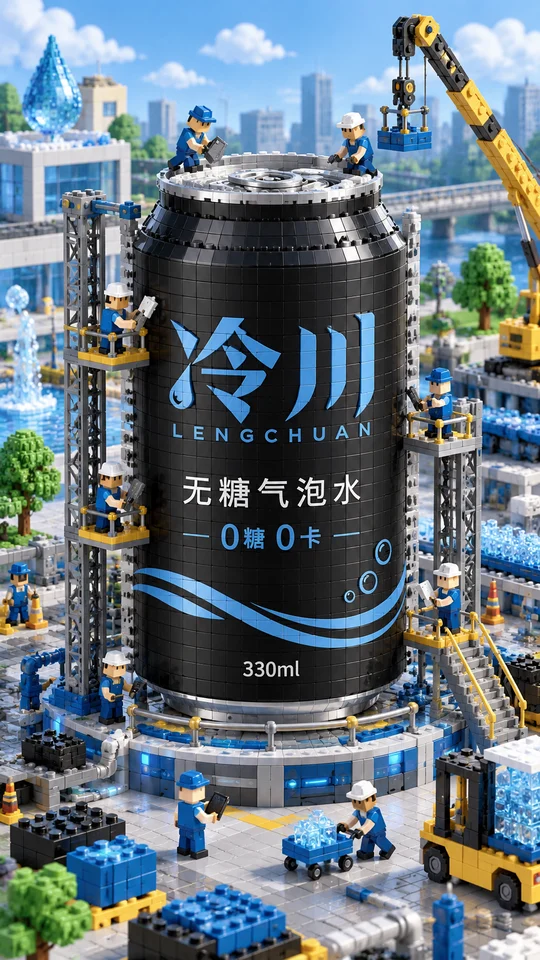

<div align="center">

# 🦁 XXD Shop 008 | Miniature Brick Construction Site

### Your product, enlarged into a brick landmark under construction

<a href="README.md">简体中文</a> · <strong>English</strong> · <a href="README.ja.md">日本語</a> · <a href="README.ko.md">한국어</a> · <a href="README.ar.md">العربية</a>

</div>

**Blow your product up into a city-sized brick landmark, with tiny brick workers busy building it.**
First glance: a giant product you recognise instantly. Second glance: what are all the little workers doing?

| At a glance | |
|---|---|
| **You give** | A product photo (required); a preferred setting or an event headline (optional) |
| **You get** | A vertical, highly finished miniature brick-world commercial poster |
| **The look** | A city-scale brick product · scaffolds and cranes · busy brick workers · matte plastic finish · bright soft light · colours grown from the product |
| **Best for** | Product launches, brand collaborations, holiday key visuals, social-media talking points |

> **Once installed, just say:**
>
> /xxd-shop-008 Make a brick construction-site poster for this sparkling-water can

<!-- xxd-samples:start -->
## Samples

<p align="center"><a href="assets/examples/s01-size-3x4-1086x1448.png"></a><br><sub>Poster · 3:4 · 1086x1448<br>SHANYU coffee beans · <a href="assets/examples/sources/product-shanyu-beans.jpg">product shot</a> + <a href="assets/examples/sources/logo-shanyu.png">Logo</a> · no added text</sub></p>

### Categories at a glance

One tile per category; click for full size. The sections below give use, ratio, pixels and input.

<table>
<tr><td align="center" valign="top"><a href="assets/examples/c01-category-3x4-1086x1448.png"></a><br><sub><b>Tea</b><br>Poster</sub></td><td align="center" valign="top"><a href="assets/examples/c02-category-9x16-941x1672.png"></a><br><sub><b>Home fragrance</b><br>Splash screen</sub></td><td align="center" valign="top"><a href="assets/examples/c03-category-3x4-1086x1448.png"></a><br><sub><b>Sports & outdoor</b><br>Poster</sub></td><td align="center" valign="top"><a href="assets/examples/c04-category-2x3-1024x1536.png"></a><br><sub><b>Home</b><br>Outdoor vertical banner</sub></td><td align="center" valign="top"><a href="assets/examples/s05-category-9x16-940x1672.png"></a><br><sub><b>Drinks</b><br>Splash screen</sub></td><td align="center" valign="top"><a href="assets/examples/s06-category-3x4-1086x1448.png"></a><br><sub><b>Food</b><br>Poster</sub></td></tr>
<tr><td align="center" valign="top"><a href="assets/examples/s01-size-3x4-1086x1448.png"></a><br><sub><b>Coffee</b><br>Poster</sub></td></tr>
</table>

### One product, every placement

Same product, same style: each ratio is a new composition, not a crop.

<table>
<tr><td align="center" valign="top"><a href="assets/examples/s01-size-3x4-1086x1448.png"></a><br><sub>Poster · 3:4 · 1086x1448<br>SHANYU coffee beans · <a href="assets/examples/sources/product-shanyu-beans.jpg">product shot</a> + <a href="assets/examples/sources/logo-shanyu.png">Logo</a> · no added text</sub></td><td align="center" valign="top"><a href="assets/examples/s02-size-9x16-941x1672.png"></a><br><sub>Splash screen · 9:16 · 941x1672<br>SHANYU coffee beans · <a href="assets/examples/sources/product-shanyu-beans.jpg">product shot</a> + <a href="assets/examples/sources/logo-shanyu.png">Logo</a> · no added text</sub></td><td align="center" valign="top"><a href="assets/examples/s03-size-2x3-1024x1536.png"></a><br><sub>Outdoor vertical banner · 2:3 · 1024x1536<br>SHANYU coffee beans · <a href="assets/examples/sources/product-shanyu-beans.jpg">product shot</a> + <a href="assets/examples/sources/logo-shanyu.png">Logo</a> · no added text</sub></td><td align="center" valign="top"><a href="assets/examples/s04-size-4x5-1122x1402.png"></a><br><sub>Social post · 4:5 · 1122x1402<br>SHANYU coffee beans · <a href="assets/examples/sources/product-shanyu-beans.jpg">product shot</a> + <a href="assets/examples/sources/logo-shanyu.png">Logo</a> · no added text</sub></td></tr>
</table>

### Across categories

<table>
<tr><td align="center" valign="top"><a href="assets/examples/c01-category-3x4-1086x1448.png"></a><br><sub>Poster · 3:4 · 1086x1448<br>YUN'AO cold-brew tea bags · <a href="assets/examples/sources/product-yunao-coldtea.jpg">product shot</a> + <a href="assets/examples/sources/logo-yunao.png">Logo</a> · no added text</sub></td><td align="center" valign="top"><a href="assets/examples/c02-category-9x16-941x1672.png"></a><br><sub>Splash screen · 9:16 · 941x1672<br>WUYU scented candle · <a href="assets/examples/sources/product-wuyu-candle.jpg">product shot</a> + <a href="assets/examples/sources/logo-wuyu.png">Logo</a> · no added text</sub></td><td align="center" valign="top"><a href="assets/examples/c03-category-3x4-1086x1448.png"></a><br><sub>Poster · 3:4 · 1086x1448<br>XUNYU sport sunglasses · <a href="assets/examples/sources/product-xunyu-sunglasses.jpg">product shot</a> + <a href="assets/examples/sources/logo-xunyu.png">Logo</a> · no added text</sub></td></tr>
<tr><td align="center" valign="top"><a href="assets/examples/c04-category-2x3-1024x1536.png"></a><br><sub>Outdoor vertical banner · 2:3 · 1024x1536<br>NUANDAO bedside lamp · <a href="assets/examples/sources/product-nuandao-lamp-bed.jpg">product shot</a> + <a href="assets/examples/sources/logo-nuandao.png">Logo</a> · no added text</sub></td><td align="center" valign="top"><a href="assets/examples/s05-category-9x16-940x1672.png"></a><br><sub>Splash screen · 9:16 · 940x1672<br>LENGCHUAN sugar-free sparkling water · <a href="assets/examples/sources/product-lc-sparkling.jpg">product shot</a> + <a href="assets/examples/sources/logo-lengchuan.png">Logo</a> · no added text</sub></td><td align="center" valign="top"><a href="assets/examples/s06-category-3x4-1086x1448.png"></a><br><sub>Poster · 3:4 · 1086x1448<br>YEFENGPO wildflower honey · <a href="assets/examples/sources/product-yfp-honey.jpg">product shot</a> + <a href="assets/examples/sources/logo-yefengpo.png">Logo</a> · no added text</sub></td></tr>
</table>

### Campaign sign

<table>
<tr><td align="center" valign="top"><a href="assets/examples/s07-special-3x4-1086x1448.png"></a><br><sub>Poster · 3:4 · 1086x1448<br>LENGCHUAN sugar-free sparkling water · <a href="assets/examples/sources/product-lc-sparkling.jpg">product shot</a> + <a href="assets/examples/sources/logo-lengchuan.png">Logo</a> · exact copy (Chinese)</sub></td></tr>
</table>

<sub>All sample products are fictional demo brands, and their prices and specs are demo values. Demo product shots and logos were made for this project, some on top of Unsplash photos; credits and licence are in [assets/examples/README.md](assets/examples/README.md). Each image is one complete generation: not retouched, composited or upscaled, with its real pixel size shown. Images that failed visual review were regenerated and are not shown. Click for full size.</sub>

<!-- xxd-samples:end -->

## What it solves

Launches, collaborations and holiday KVs often need an image people stop to explore. A normal product shot cannot do it, and pure 3D cartoons make the product unrecognisable.

**Shop 008** tells a small story: the product, enlarged to city scale and built from bricks, stands in the middle of a miniature world; scaffolds, cranes and maintenance platforms surround it while brick workers carry, polish, wipe, post and inspect. The setting extends from the category — logistics for drinks, a clean lab bench for skincare.

## About "LEGO style"

It is a building style, not a brand. No real brick brand's logos, wordmarks or proprietary minifigure designs appear anywhere, studs included; the workers are generic square-headed brick figures.

## What to prepare

- **A product photo** (required): packaging, colours, logo and text layout all come from it and must stay recognisable once bricked.
- **A setting** (optional): say it if you have one in mind, such as "a logistics warehouse" or "a lab bench".
- **An event headline** (optional): it becomes a site sign placed clear of the product.

## How to use it

### Step 1: install (once)

```bash
git clone https://github.com/nevertoday/xxd-shop-008.git
mkdir -p ~/.claude/skills
ln -s "$(pwd)/xxd-shop-008" ~/.claude/skills/xxd-shop-008
```

Codex users link the same folder into `~/.codex/skills/xxd-shop-008`. Restart your AI assistant's session after installing.

### Step 2: say what you want in plain words

```text
/xxd-shop-008 Make a brick construction-site poster for this sparkling-water can
/xxd-shop-008 A 9:16 one for this tumbler, with a site sign reading "New product under construction · opens Sept 20"
/xxd-shop-008 Two different construction stories for this coffee bag
```

No flags to memorise. Anything you leave open, such as sizes or how many, is asked in one go, and next time you can reuse your previous settings.

### Step 3: what it does next

1. Reads your product photo and description and asks only what is still open; sizes are recommended from the use, with pixel dimensions.
2. This style adds no text by default (the only words are the product's own packaging) and does not ask about it; a headline you give becomes a site sign.
3. Every size is composed afresh, never cropped from another image.
4. Checks each image before delivery: is the product unchanged, is the text spelled right, are there numbers you never gave? Anything that fails is reported and redone.
5. Saves PNGs to a new task folder under `~/Desktop/xxd/xxd-shop-008/` and gives you the path.

<details>
<summary><strong>Advanced: command flags (for later)</strong></summary>

```text
/xxd-shop-008 ./sparkling-water.png --size 3:4 --text none
/xxd-shop-008 ./tumbler.png --size 9:16 --text exact --copy "Under construction · opens Sept 20" --locale en-US
```

Key flags: `--size` (the style is vertical), `--count`, `--text none / exact`, `--locale`. Full list in the [runtime reference](references/shop-runtime.md).

</details>

## FAQ

**Can it be horizontal?**

Yes, but the style is composed vertically; landscape weakens the landmark effect, and it tells you so first.

**What do I need?**

Three things: ① an AI assistant that supports Skills, such as Claude Code or Codex; ② an image-capable model — your assistant's built-in image generation, or a model provider configured in Codex that generates images through the Responses API (GPT Image 2 by default); ③ Python 3.11+ with Pillow (`pip install pillow`).

**Does it cost anything? Can I use it commercially?**

The Skill is free to download; image generation is billed to your own model account. Making images for your own products, shop or brand (or your employer's, as an employee) is free for commercial use, no permission needed; reselling the Skill, turning it into a paid service, or making images for others for a fee needs the author's written permission first. See "License" at the end.

**How large are the images?**

You can ask for a ratio or exact pixels. The real size is whatever the model returns — never secretly upscaled — and the file name states the true pixels.

**Will the text in the image have typos?**

AI images occasionally misspell words or add small marks such as ® next to a brand name. Every image is zoomed and checked before delivery, and any failure is redone; all samples on this page passed that check.

**Will it invent prices or sales numbers?**

No. Anything that looks like a fact — price, specs, origin, sales, awards, certifications — comes only from what you provide or text clearly readable on the product; otherwise it is left out, with no "¥XX" placeholder.

**Can it handle many products at once?**

Yes. Give it a folder of product photos: each image is one product, sizes and text are asked once, and no product's facts or copy leak into another's.

## Principles

- **The style stays true:** behind this Skill is a mature commercial design prompt ([original brief](references/original-prompt/zh-CN.md) · [English reading translation](references/original-prompt/en.md)). The Skill never rewrites it or adds its own colours or art direction; it only hands the model your product, sizes, text and facts.
- **The product is not redesigned:** with a product photo, shape, colour, packaging text and logo follow the photo.
- **Only your facts,** and each product stands alone — nothing borrowed from other products, earlier results or samples.
- **Real PNG bitmaps,** never SVG or code drawings passed off as images; every run creates a new task folder.
- Product recognition beats every construction detail: logo, brand name and main packaging text stay legible and unblocked.

<!-- xxd-shop-tail -->
<details>
<summary><strong>Project structure (for developers)</strong></summary>

```text
xxd-shop-008/
├── SKILL.md
├── README.md / README.en.md / README.ja.md / README.ko.md / README.ar.md
├── LICENSE
├── agents/openai.yaml
├── assets/examples/
├── scripts/
│   ├── configured_imagegen.py
│   ├── clean_marks.py
│   └── shop_preferences.py
└── references/
    ├── shop-runtime.md
    ├── runtime-preferences.md
    ├── sample-workflow.md
    └── original-prompt/
        ├── README.md
        ├── zh-CN.md
        └── en.md
```

</details>

<!-- xxd-readme-ads:start -->
## About XXD

XXD is Xiaoxiaodong's abbreviated brand name. This project is created and maintained by [@xiaoxiaodong01](https://x.com/xiaoxiaodong01).

## Xiaoxiaodong multi-platform membership · CNY 699/year

> **Advertising disclosure:** The QR code, membership, and paid-service links below are XXD promotional information. Scanning or purchasing is entirely optional and does not affect access to this open-source project.

One annual membership unlocks three benefits together: **Knowledge Planet + the XXD Member Prompt Library + membership for all General Skills**. They are included in one membership; no separate purchase is required.

<!-- xxd-shop-command-system:start -->

### How the Skills work together

| Level | Included | What it does |
|---|---|---|
| **General** | `xxd-shop-all` | Detects available numbered Skills, recommends them by product, placement and visual need, and organizes multi-style and batch tasks. |
| **Soldier** | `xxd-shop-NNN` | Each numbered Skill follows its own original brief and aesthetic to complete the specific task assigned by the General. |

<!-- xxd-shop-command-system:end -->

### What you receive

1. **One-to-one WeChat AI learning and project support**
   Add Xiaoxiaodong on WeChat via the QR code below to discuss AI learning, tools, and real projects one to one, with practical guidance and answers. Representative questions may be organized into member resources.
2. **A growing member prompt library**
   The [XXD Member Prompt Library](https://vip.xiaoxiaodong.ai/) currently contains about 32,000 prompts and will keep expanding, with a goal of exceeding 100,000.
3. **All General Skills and usage support**
   One membership covers every General Skill, with usage guidance and Q&A when you need help.
4. **Priority for high-need requests**
   Frequently requested, high-need prompts and Skills are reviewed and developed first where appropriate.

### How to join

- [Activate membership on the member website](https://vip.xiaoxiaodong.ai/).
- Or scan the QR code below to add Xiaoxiaodong on WeChat for one-to-one activation support.

<p align="center"><a href="https://xiaoxiaodong.pages.dev/assets/wechat-qr.png"></a></p>
<!-- xxd-readme-ads:end -->

## License

This project—including its Skill, prompts, scripts, documentation, and accompanying samples—is released under the **PolyForm Noncommercial License 1.0.0**, with an additional own-business-use permission at the top of [LICENSE](LICENSE). The complete legal text is in [LICENSE](LICENSE); the official page is <https://polyformproject.org/licenses/noncommercial/1.0.0>.

In plain language:

- **Free for sellers' own use:** making images for your own products, shop or brand—or for your employer's, as an employee—is allowed, and so is adapting the Skill for it. The images may be used commercially (listings, ads, packaging) without asking.
- You may use it for personal study, research, experiments, testing, hobbies, and private entertainment. Charities, educational institutions, public research/safety/health organisations, environmental-protection organisations, and government institutions may also use it.
- For **noncommercial purposes**, you may copy, modify, create derivative works, and share the project. When sharing, include this license (with the additional permission) and every `Required Notice:` line in it.
- **These need a separate written commercial license:** reselling or distributing the Skill, its prompts or adaptations for a fee; turning it into a paid tool, hosted service or API; making images for other people for a fee (studios, agencies, store operators, freelance work); using it as material for paid courses or training. Contact [@xiaoxiaodong01](https://x.com/xiaoxiaodong01) or use the QR code above.
- The license grants only the stated copyright and limited patent rights. It grants no trademark, brand, or other unstated rights, and you may not sublicense or transfer your license.
- If you receive written notice of a violation, you have 32 days to come into full compliance and take practical corrective steps; otherwise the licenses end. A written patent-infringement claim also ends the patent license.
- The project is provided **as is**, without warranties, and you accept the risks and any resulting liability to the extent permitted by law.
