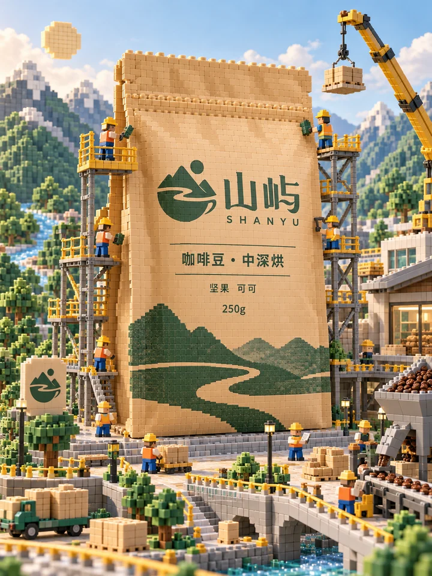
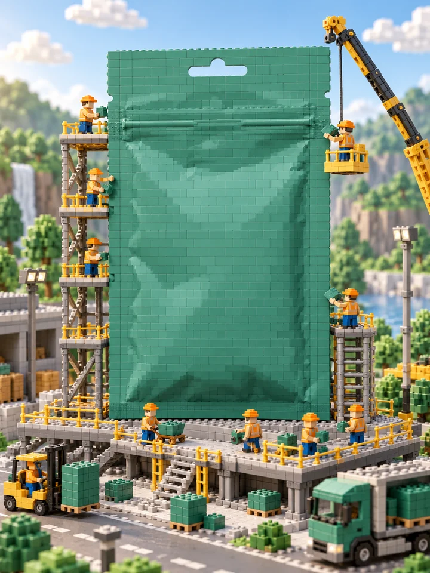
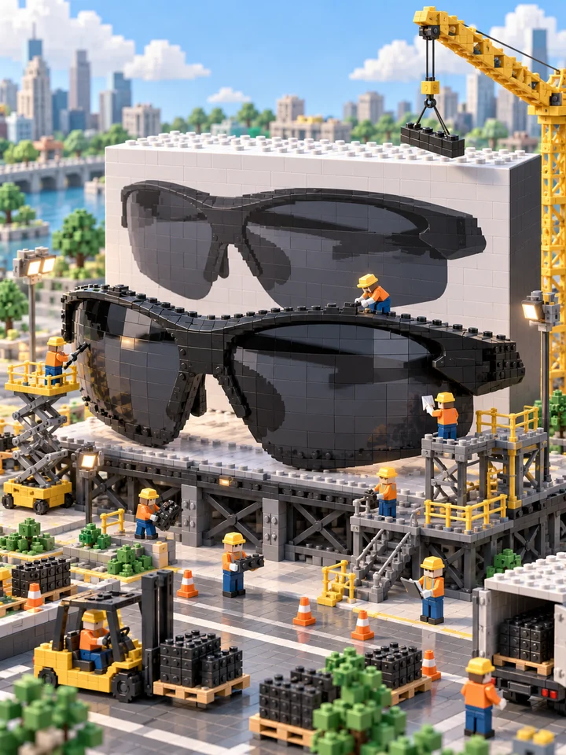
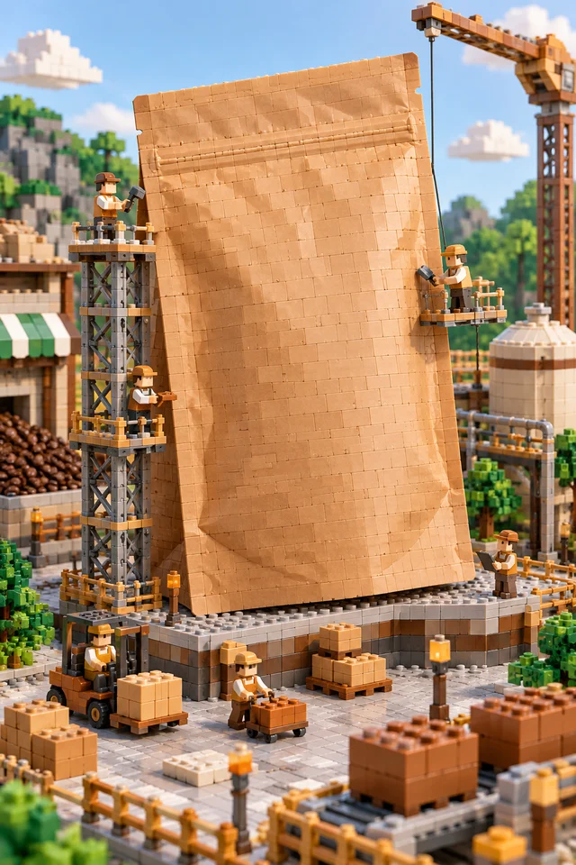
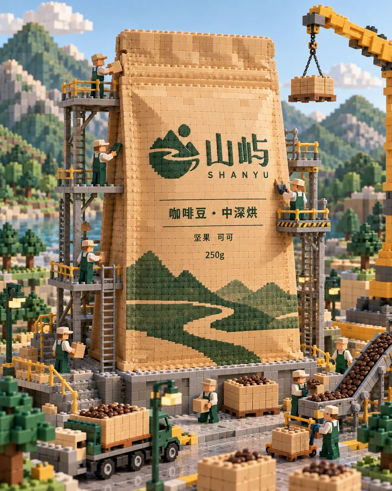

<div align="center">

# 🦁 XXD Shop 008｜微缩积木工地

### 你的商品，被放大成一座正在施工的积木地标

<strong>简体中文</strong> · <a href="README.en.md">English</a>

</div>

> 原始提示词：[简体中文原文](references/original-prompt/zh-CN.md) · [English](references/original-prompt/en.md)

<!-- xxd-samples:start -->
## 样张

<p align="center"><a href="assets/examples/s01-size-3x4-1086x1448.png"></a><br><sub>海报 · 3:4 · 1086x1448<br>山屿 咖啡豆 · <a href="assets/examples/sources/kraft-pouch.jpg">原图</a> · 不加字</sub></p>

### 能做哪些品类

每格一个品类，点开看大图；下面各段有用途、比例、像素和输入说明。

<table>
<tr><td align="center" valign="top"><a href="assets/examples/c01-category-3x4-1086x1448.png"></a><br><sub><b>茶饮</b><br>海报</sub></td><td align="center" valign="top"><a href="assets/examples/c02-category-9x16-941x1672.png"></a><br><sub><b>香氛家居</b><br>开屏</sub></td><td align="center" valign="top"><a href="assets/examples/c03-category-3x4-1086x1448.png"></a><br><sub><b>运动户外</b><br>海报</sub></td><td align="center" valign="top"><a href="assets/examples/c04-category-2x3-1024x1536.png"></a><br><sub><b>家居</b><br>户外竖幅</sub></td><td align="center" valign="top"><a href="assets/examples/s05-category-9x16-941x1672.png"></a><br><sub><b>饮料</b><br>开屏</sub></td><td align="center" valign="top"><a href="assets/examples/s06-category-3x4-1086x1448.png"></a><br><sub><b>食品</b><br>海报</sub></td></tr>
<tr><td align="center" valign="top"><a href="assets/examples/s01-size-3x4-1086x1448.png"></a><br><sub><b>咖啡</b><br>海报</sub></td></tr>
</table>

### 一个商品，适配每个位置

同一商品、同一份原稿，每个比例都重新构图，不是裁切。

<table>
<tr><td align="center" valign="top"><a href="assets/examples/s01-size-3x4-1086x1448.png"></a><br><sub>海报 · 3:4 · 1086x1448<br>山屿 咖啡豆 · <a href="assets/examples/sources/kraft-pouch.jpg">原图</a> · 不加字</sub></td><td align="center" valign="top"><a href="assets/examples/s02-size-9x16-941x1672.png"></a><br><sub>开屏 · 9:16 · 941x1672<br>山屿 咖啡豆 · <a href="assets/examples/sources/kraft-pouch.jpg">原图</a> · 不加字</sub></td><td align="center" valign="top"><a href="assets/examples/s03-size-2x3-1024x1536.png"></a><br><sub>户外竖幅 · 2:3 · 1024x1536<br>山屿 咖啡豆 · <a href="assets/examples/sources/kraft-pouch.jpg">原图</a> · 不加字</sub></td><td align="center" valign="top"><a href="assets/examples/s04-size-4x5-1122x1402.png"></a><br><sub>社媒 · 4:5 · 1122x1402<br>山屿 咖啡豆 · <a href="assets/examples/sources/kraft-pouch.jpg">原图</a> · 不加字</sub></td></tr>
</table>

### 换一个品类也成立

<table>
<tr><td align="center" valign="top"><a href="assets/examples/c01-category-3x4-1086x1448.png"></a><br><sub>海报 · 3:4 · 1086x1448<br>云坳 冷泡茶包 · <a href="assets/examples/sources/pouch-green.jpg">原图</a> · 不加字</sub></td><td align="center" valign="top"><a href="assets/examples/c02-category-9x16-941x1672.png"></a><br><sub>开屏 · 9:16 · 941x1672<br>雾屿 香薰蜡烛 · <a href="assets/examples/sources/candle-jar.jpg">原图</a> · 不加字</sub></td><td align="center" valign="top"><a href="assets/examples/c03-category-3x4-1086x1448.png"></a><br><sub>海报 · 3:4 · 1086x1448<br>迅屿 运动太阳镜 · <a href="assets/examples/sources/sunglasses-sport.jpg">原图</a> · 不加字</sub></td></tr>
<tr><td align="center" valign="top"><a href="assets/examples/c04-category-2x3-1024x1536.png"></a><br><sub>户外竖幅 · 2:3 · 1024x1536<br>暖岛 床头灯 · <a href="assets/examples/sources/lamp-black.jpg">原图</a> · 不加字</sub></td><td align="center" valign="top"><a href="assets/examples/s05-category-9x16-941x1672.png"></a><br><sub>开屏 · 9:16 · 941x1672<br>冷川 无糖气泡水 · <a href="assets/examples/sources/black-can.jpg">原图</a> · 不加字</sub></td><td align="center" valign="top"><a href="assets/examples/s06-category-3x4-1086x1448.png"></a><br><sub>海报 · 3:4 · 1086x1448<br>野蜂坡 百花蜜 · <a href="assets/examples/sources/honey-jar.jpg">原图</a> · 不加字</sub></td></tr>
</table>

### 活动告示牌

<table>
<tr><td align="center" valign="top"><a href="assets/examples/s07-special-3x4-1086x1448.png"></a><br><sub>海报 · 3:4 · 1086x1448<br>冷川 无糖气泡水 · <a href="assets/examples/sources/black-can.jpg">原图</a> · 准确文案（中文）</sub></td></tr>
</table>

<sub>样张商品均为虚构的演示品牌，价格、规格等数字为演示设定；商品原图来自 Unsplash，署名与许可见 [assets/examples/README.md](assets/examples/README.md)。每张都是单次生成的完整画面，未修图、未拼接、未放大，像素照实标注；没通过目视验收的已重出，不放进来。点开看原尺寸。</sub>

<!-- xxd-samples:end -->

## 它解决什么

新品上市、品牌联名、节日 KV，常常需要一张“让人想停下来看细节”的图。普通产品照做不到，纯 3D 卡通又会把商品画得认不出来。

**Shop 008** 的做法是讲一个小故事：商品被放大到城市尺度，由积木颗粒拼成，立在一个微缩世界中央；周围有脚手架、吊装机械、维修平台，一群积木小工人在搬运、打磨、擦拭、张贴、巡检。

第一眼看到巨型商品，而且一眼认得出它是谁；第二眼才开始找小人在干什么。

## 你需要准备

- **商品图：** 必需。包装、配色、Logo 和文字布局都从这张图来，积木化之后仍要认得出。
- **想要的场景（可选）：** 原稿会按品类自动延展场景，比如饮料配物流仓储，护肤品配洁净实验台。你有想法可以直接写进描述。

## 关于“乐高风”

这是一种拼搭风格，不是一个品牌。画面里不会出现任何真实积木品牌的标识、字样或专有人仔造型，凸点上也不会。

## 快速判断

| 你关心的问题 | 回答 |
|---|---|
| **你会得到什么** | 一张竖版、高完成度的积木微缩世界商业海报 |
| **一眼可辨的特点** | 城市尺度的积木商品 · 脚手架与吊臂 · 忙碌的积木工人 · 哑光 ABS 质感 · 明亮柔和的光 · 配色从商品长出 |
| **它不会做什么** | 不让商品认不出来、不挡住包装文字、不做低幼卡通、不出现积木品牌标识 |

## 开始使用

```bash
git clone https://github.com/nevertoday/xxd-shop-008.git
ln -s "$(pwd)/xxd-shop-008" ~/.claude/skills/xxd-shop-008
```

```text
# 竖版海报，画面上的字只有包装本身
/xxd-shop-008 ./气泡水.png --size 3:4 --text none

# 加一块施工告示牌当活动标题
/xxd-shop-008 ./保温杯.png --size 9:16 --text exact --copy "新品施工中 · 9 月 20 日开放" --locale zh-CN

# 同一商品出两张不同的施工故事
/xxd-shop-008 ./咖啡豆.png --size 3:4 --count 2 --text none
```

常用参数：`--size`（原稿是竖版） · `--count` · `--text none / exact` · `--locale`。完整参数见[家族运行合同](references/shop-runtime.md)。

## 边界与信任

- 原始提示词逐字保存，是唯一的审美权威。
- 商品识别度优先于一切施工细节：Logo、品牌名和主要包装文字必须可读，不被遮挡。
- 交付 PNG 位图；每次调用都新建任务目录。

<!-- xxd-shop-tail -->
## 项目结构

```text
xxd-shop-008/
├── SKILL.md
├── README.md / README.en.md
├── LICENSE
├── agents/openai.yaml
├── assets/examples/
├── scripts/
│   ├── configured_imagegen.py
│   └── shop_preferences.py
└── references/
    ├── shop-runtime.md
    ├── runtime-preferences.md
    ├── sample-workflow.md
    └── original-prompt/
        ├── README.md
        ├── zh-CN.md
        └── en.md
```

<!-- xxd-readme-ads:start -->
## 关于 XXD

XXD 是小小东品牌名的缩写，本项目由小小东创建并维护：[@xiaoxiaodong01](https://x.com/xiaoxiaodong01)。

## 小小东多端会员 · 699 元/年

> **广告与商业信息声明：** 以下二维码、会员与付费服务链接属于小小东的广告信息。是否扫码或购买完全自愿，不影响本开源项目的访问与使用。

一次年费，同时开通三项会员权益：**知识星球 + 小小东成员提示词库 + 全部 将军总指挥 Skills 会员**。三项权益合并在同一份会员中，无需分别购买。

<!-- xxd-shop-command-system:start -->

### Skills 如何协作

| 层级 | 包含内容 | 用途 |
|---|---|---|
| **General** | `xxd-shop-all` | 识别可用的编号 Skills，按商品、用途和画面需求推荐，并组织多风格试稿与批量任务。 |
| **Soldier** | `xxd-shop-NNN` | 每个编号执行自己的原始提示词与审美，完成 General 分派的具体任务。 |

<!-- xxd-shop-command-system:end -->

### 会员权益

1. **微信一对一 AI 学习与项目答疑**
   扫描下方二维码，添加小小东微信，围绕 AI 学习、工具使用和实际项目进行一对一沟通，获得答疑与建议；代表性问题将整理为会员内容。
2. **持续更新的成员提示词库**
   [小小东成员提示词库](https://vip.xiaoxiaodong.ai/)当前约有 3.2 万条提示词，会持续整理和扩充，目标超过 10 万条。
3. **全部 将军总指挥 Skills 与使用答疑**
   一份会员覆盖全部 将军总指挥 Skills；使用过程中遇到问题，可以获得相应的使用说明与答疑。
4. **高频刚需优先处理**
   会员提出的高频、刚需提示词与 Skills 需求，会优先评估和开发。

### 如何开通

- 可在[成员网站](https://vip.xiaoxiaodong.ai/)自助开通。
- 也可以扫描下方二维码，添加小小东微信，进行一对一沟通并获得开通协助。

<p align="center"><a href="https://xiaoxiaodong.pages.dev/assets/wechat-qr.png"></a></p>
<!-- xxd-readme-ads:end -->

## 许可证

本项目（包括 Skill、提示词、脚本、文档及随附样张）采用 **PolyForm Noncommercial License 1.0.0**。完整法律条文请见 [LICENSE](LICENSE)，官方页面见 <https://polyformproject.org/licenses/noncommercial/1.0.0>。

用人话说：

- 个人可以用于学习、研究、实验、测试、兴趣项目和私人娱乐；慈善机构、教育机构、公共研究/安全/卫生机构、环保组织及政府机构也可以使用。
- 在**非商业目的**下，你可以使用、复制、修改、制作衍生作品并分享；分享时必须同时提供本许可证（或上面的链接）以及作者提供的所有 `Required Notice:` 声明。
- 不允许用于商业产品或服务、收费交付、出售访问权或许可，或任何预期会带来商业应用的用途。需要商业使用时，请先向版权方另行取得书面许可。
- 本协议只授予其中明确写出的著作权许可和有限的专利许可，不授予商标、品牌名称或其他未明确授予的权利，也不能把你的许可再转授给他人。
- 如果收到书面违约通知，须在 32 天内纠正并采取实际补救措施，否则许可会立即终止；就专利侵权提出书面主张也会终止专利许可。
- 内容按“现状”提供，在法律允许的范围内不作任何担保，使用风险和可能的损失由使用者自行承担。
